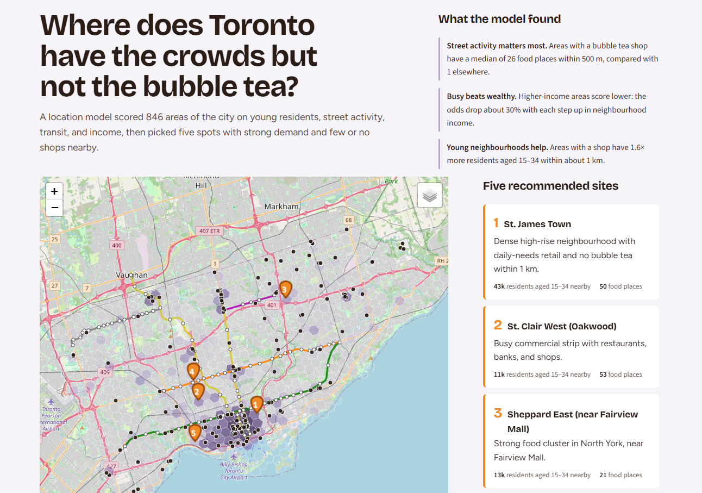
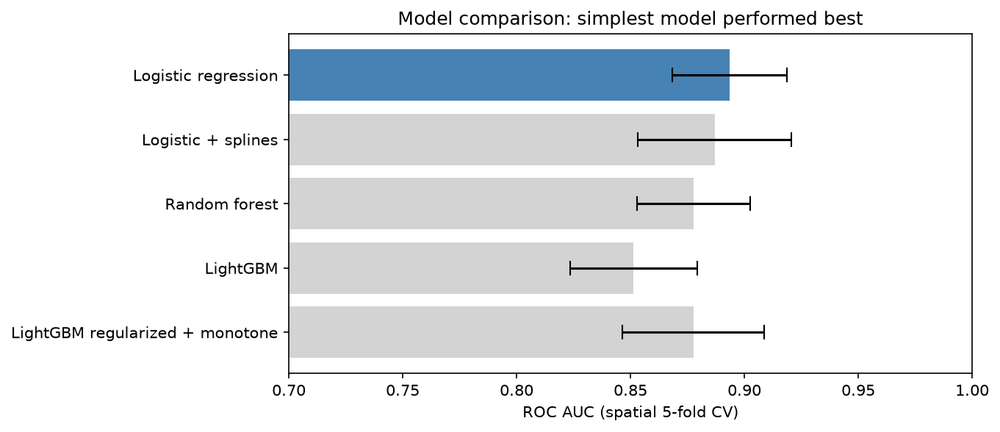

# Where does Toronto have the crowds but not the bubble tea?

**🧋 Live app: [toronto-bubble-tea.streamlit.app](https://toronto-bubble-tea.streamlit.app)**

A geospatial site selection model that scores every part of Toronto on how suitable it is for a bubble tea shop, then recommends five locations after accounting for competition and a field check. Built with census, transit, school, and OpenStreetMap data, and validated with spatial cross-validation.



## The answer: five recommended sites

| Rank | Area | Why |
|---|---|---|
| 1 | St. James Town | 43,000 residents aged 15–34 nearby, daily-needs retail, no bubble tea within 1 km |
| 2 | St. Clair West (Oakwood) | Busy commercial strip with 53 food places |
| 3 | Sheppard East (near Fairview Mall) | Strong food cluster in North York |
| 4 | Eglinton West (Little Jamaica) | On the new Line 5 Eglinton, so foot traffic should keep growing |
| 5 | Queen West (Parkdale / Roncesvalles) | High foot traffic, with higher-income residents nearby |

## Key findings

- **Street activity matters most.** Areas with a bubble tea shop have a median of 26 food places within 500 m, compared with 1 elsewhere.
- **Busy beats wealthy.** Higher-income areas score lower: the odds drop about 30% per standard deviation of neighbourhood income.
- **Young neighbourhoods help.** Areas with a shop have 1.6× more residents aged 15–34 within about 1 km.
- **The simplest model won.** Logistic regression outperformed LightGBM and random forest under spatial cross-validation, because only 94 areas contain a shop and flexible models overfit.

## How it works

1. **Grid:** Toronto is covered with 852 H3 hexagons (resolution 8, ~0.8 km² each). 846 are mostly land.
2. **Census data:** 2021 Census data for 3,743 dissemination areas is moved onto the hexagons with areal interpolation (counts split by area, income as a population-weighted average).
3. **Location features:** distance to the nearest subway/LRT station and major campus, high schools within 1 km, food & drink places within 500 m, and residents aged 15–34 within ~1 km (H3 neighbours).
4. **Target:** whether a hexagon contains an existing bubble tea shop (178 shops, 94 hexagons).
5. **Model:** logistic regression (median imputation → log transform → standardization), evaluated with spatial cross-validation.
6. **Ranking:** opportunity = suitability × 1 / (1 + competitors within 1 km), a simplified Huff model. Sites must have at least the city-median number of young residents nearby and 3+ food places, and be at least 1.5 km apart.
7. **Field check:** the top 10 were reviewed in Google Maps and Street View ([`data/manual/site_checks.csv`](data/manual/site_checks.csv)), and the top 5 kept sites form the final list.

## Model results

Spatial 5-fold cross-validation: hexagons are grouped into 25 blocks by their H3 resolution-6 parent (~36 km²), and whole blocks are held out together.

| Model | ROC AUC | Avg precision |
|---|---|---|
| **Logistic regression** | **0.894 ± 0.025** | **0.584 ± 0.126** |
| Logistic + splines | 0.887 ± 0.034 | 0.570 ± 0.116 |
| Random forest | 0.878 ± 0.025 | 0.514 ± 0.103 |
| LightGBM, regularized + monotone | 0.878 ± 0.031 | 0.537 ± 0.129 |
| LightGBM | 0.851 ± 0.028 | 0.476 ± 0.120 |

Average precision of 0.584 is about 5× the random baseline of 0.111. ROC AUC of 0.894 means the model ranks an area with a shop above one without 89% of the time, in parts of the city it never trained on.

- **Spatial vs. random split (LightGBM):** 0.851 vs. 0.858. Features cluster strongly (Moran's I up to 0.87), but the small gap shows the model generalizes to unseen areas rather than memorizing location.
- **Ablation:** without food places, spatial AUC is 0.773. Demographic and location features carry independent signal; commercial activity improves accuracy and consistency.



## Design decisions

- **Spatial cross-validation:** neighbouring hexagons look alike, so a random split would put near-identical areas in both training and test sets.
- **Avoiding leakage:** bubble tea shops are excluded from the food-places count, and nearby competitors are not a model input. Including them would teach the model that shops cluster near shops, without explaining *why* a location is good. Competition is applied at the ranking step instead.
- **Simplest model chosen:** no alternative beat logistic regression in more than 2 of 5 folds, so the most explainable model was selected.
- **Commercial centers:** each recommended site is placed at the median location of food places inside its hexagon. An earlier version placed a site at a hexagon's geometric center, which fell in the Humber River.
- **Edge effects:** stations just outside the city (e.g., Vaughan Metropolitan Centre) are kept, so hexagons near the boundary aren't penalized.
- **Reproducible data:** the public Overpass API restricts automated requests, so stations come from TTC GTFS and schools from Statistics Canada files rather than live OpenStreetMap queries.

## Data sources

| Data | Source |
|---|---|
| Population, age, income | Statistics Canada, 2021 Census Profile (dissemination areas) |
| Census boundaries | Statistics Canada, 2021 cartographic boundary files |
| Subway & LRT stations | TTC GTFS schedule data, City of Toronto Open Data |
| High schools | Statistics Canada, Open Database of Educational Facilities (v2.1) |
| Major campuses | Hand-checked list, [`data/manual/major_campuses.csv`](data/manual/major_campuses.csv) |
| Bubble tea shops, food & drink places | OpenStreetMap contributors, via OSMnx |

## Limitations

- **Suitability, not profitability.** The model learns where shops already exist, not which ones succeed. Rent, sales, and competitor quality aren't included.
- **OpenStreetMap coverage.** Volunteer mapping misses some shops (Google Maps showed nearby shops missing from OSM at 3 of the 10 shortlisted sites) and is more complete downtown than in the suburbs.
- **Even population spread.** Areal interpolation assumes people are spread evenly within each census area.
- **Single reviewer.** The field check reflects one person's judgment, documented for transparency.
- **Data age.** School data was collected 2019–2022, and census data is from 2021.

## Future work

- Add commercial rent and City of Toronto pedestrian counts.
- Include planned transit (e.g., the Scarborough Subway Extension) to find areas that will gain foot traffic.
- Extend to Montreal, Vancouver, and Calgary, and test whether a Toronto-trained model transfers.
- Use a full Huff model with store attractiveness and distance decay.
- Cross-check shop locations against a second source.
- Use dasymetric mapping to place population only on residential land.

## Repository structure

```
├── app/                  # Streamlit app and its small data files
├── data/
│   ├── manual/           # Hand-checked campuses and field check results
│   ├── raw/              # Downloaded source data (not in Git)
│   └── processed/        # Intermediate outputs (not in Git)
├── figures/              # Charts used in this README and the app
├── notebooks/            # Analysis, in order
│   ├── 01_city_boundary.ipynb
│   ├── 02_hex_grid.ipynb
│   ├── 03_census.ipynb
│   ├── 04_census_to_hex.ipynb
│   ├── 05_bubble_tea.ipynb
│   ├── 06_foot_traffic.ipynb
│   ├── 07_model_features.ipynb
│   ├── 08_exploration.ipynb
│   ├── 09_model.ipynb
│   └── 10_site_ranking.ipynb
└── requirements.txt
```

## How to run

**The app only:**

```bash
git clone https://github.com/shaheryar-haider/retail-site-selection.git
cd retail-site-selection
python -m venv venv
source venv/Scripts/activate      # Windows (Git Bash). Mac/Linux: source venv/bin/activate
pip install -r app/requirements.txt
streamlit run app/app.py
```

**The full analysis:** install `requirements.txt`, download the raw data into `data/raw/`, then run the notebooks in order.

| Folder | Download |
|---|---|
| `data/raw/boundaries/` | 2021 Census cartographic boundary file, dissemination areas (`lda_000b21a_e`) |
| `data/raw/census/` | 2021 Census Profile comprehensive download, Ontario DAs (`98-401-X2021006`) |
| `data/raw/ttc_gtfs/` | TTC Routes and Schedules (GTFS), City of Toronto Open Data |
| `data/raw/odef/` | Open Database of Educational Facilities v2.1, Statistics Canada |

## Built with

Python, GeoPandas, H3, OSMnx, PySAL (libpysal, esda), scikit-learn, LightGBM, Folium, Streamlit
